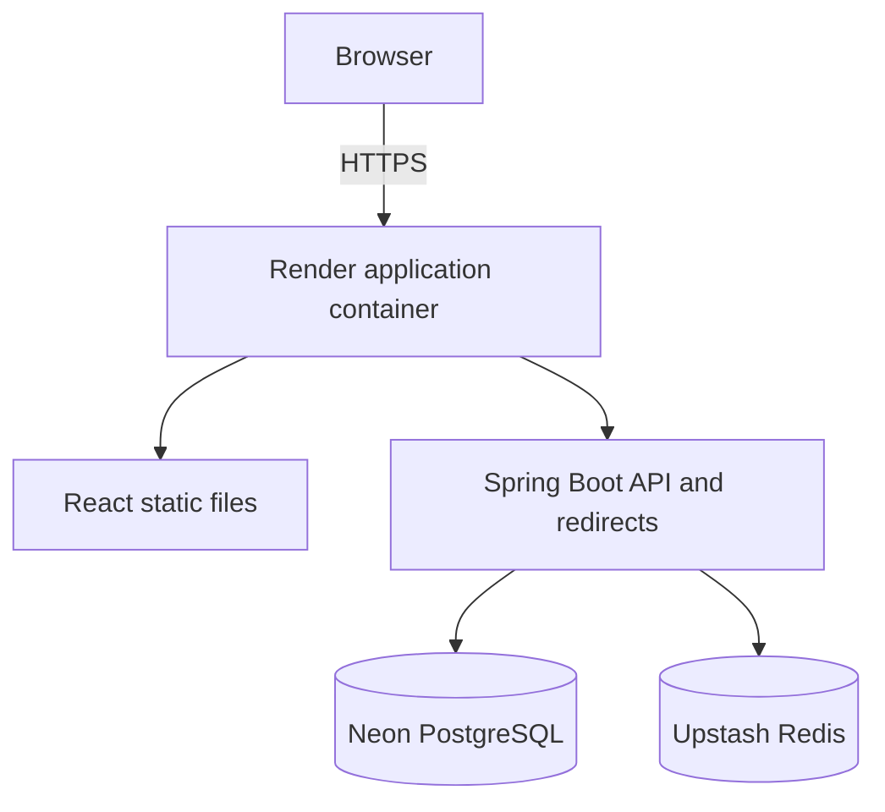

# LinkScale

**A full-stack URL shortener with account-based link management, click analytics, Redis caching, and rate limiting.**

[Live demo](https://linkscale-qbqn.onrender.com) · [GitHub Actions](https://github.com/vanshgarg-code/linkscale/actions) · [Report an issue](https://github.com/vanshgarg-code/linkscale/issues)

[](https://github.com/vanshgarg-code/linkscale/actions/workflows/ci.yml)

LinkScale lets users create short links, manage their availability, and see when they are visited. It combines a React and TypeScript frontend with a Spring Boot REST API, PostgreSQL persistence, and Redis-backed redirect caching and request limits.

The application is deployed as one Docker service on Render, with PostgreSQL on Neon and Redis on Upstash. The frontend, API, and public redirects share one HTTPS origin.

> The demo uses free hosting. The first request after inactivity may take longer while the service starts. Use a test password that you do not reuse elsewhere.

## Features

### Accounts and sessions

- Register, sign in, restore the current session on refresh, and sign out.
- Store passwords using Spring Security's delegating password encoder with BCrypt as the default.
- Protect state-changing requests with CSRF tokens, including login and registration.
- Restrict link management and analytics to the account that owns the link.
- Use secure session and CSRF cookies in production.
- Show or hide the password in login and signup forms.

### Short links and management

- Create short URLs with randomly generated eight-character lowercase alphanumeric codes.
- Support custom aliases, optional titles, and expiry dates through the creation API.
- Open active short links without signing in, using HTTP 302 redirects.
- Browse owned links in a dashboard with search, status filters, and pagination.
- Copy short URLs, edit titles and expiry dates, deactivate or reactivate links, and soft-delete them.
- Stop redirects for expired, inactive, or deleted links.

The web shortening form accepts a destination URL. Custom aliases and optional creation metadata are currently exposed through the API; the dashboard supports editing titles and expiry dates after creation.

### Click analytics

- Record a click event for each successful public GET redirect, including cache hits and repeat visits.
- View click totals, a daily chart, and daily counts for the last 7, 30, or 90 days in the dashboard.
- Query any analytics window from 1 to 90 days through the API.
- Group dates in UTC and include days with zero clicks.

Click totals represent recorded visits within the selected window, not unique visitors. HEAD requests do not record clicks. Recording is best-effort: a failed analytics write does not prevent the redirect.

### Redis caching and rate limiting

- Resolve redirects through a cache-aside Redis cache with PostgreSQL as the source of truth.
- Cache entries for at most 60 seconds, capped by link expiry.
- Evict cached entries when links change or are deleted.
- Fall back to PostgreSQL when the redirect cache is unavailable.
- Apply Redis-backed rate limits to login, registration, and link creation.

| Action | Limit per 60-second window | Bucket |
| --- | ---: | --- |
| Login | 10 requests | Client IP |
| Registration | 5 requests | Client IP |
| Link creation | 30 requests | Account ID |

Requests reaching these controller checks count even if credentials or link details are subsequently rejected. Exceeding the limit returns HTTP `429` with a `Retry-After` header. If Redis cannot check a limit, these actions return HTTP `503`; redirect-cache failures instead use the database fallback.

## Technology stack

| Area | Technologies |
| --- | --- |
| Backend | Java 21, Spring Boot 4.1.2, Spring Security, Spring JDBC |
| Frontend | React 18, TypeScript, Vite, React Router, Tailwind CSS |
| UI | Recharts, Lucide icons |
| Database | PostgreSQL 17, Flyway migrations |
| Cache and limits | Redis |
| Backend tests | JUnit, Spring Boot Test, Testcontainers |
| Browser tests | Playwright with Chromium |
| Build and delivery | Maven Wrapper, npm lockfile, Docker, GitHub Actions |
| Hosting | Render, Neon PostgreSQL, Upstash Redis |

## Architecture



The Docker build compiles the frontend and packages its assets inside the Spring Boot JAR. Spring Boot serves frontend routes, handles session authentication, and processes API and redirect requests. PostgreSQL stores accounts, links, and click events; Redis stores short-lived redirect entries and rate-limit buckets.

Flyway applies versioned database migrations during application startup. Integration tests use isolated Testcontainers services rather than the production database.

## Run locally

The commands below use Windows PowerShell. Keep the backend and frontend terminals open while testing.

### Prerequisites

- Java 21 JDK.
- Node.js 24 and npm, matching the CI environment.
- Git.
- Docker Desktop with the Docker daemon running.

Maven is provided by the wrapper in `backend/`.

### 1. Clone and start local services

```powershell
git clone https://github.com/vanshgarg-code/linkscale.git
Set-Location linkscale
Copy-Item .env.example .env
docker compose up -d
docker compose ps
```

For an existing checkout, do not overwrite an existing `.env` file. The supplied defaults are for local development only. Compose starts PostgreSQL and Redis on loopback ports `5432` and `6379` and preserves PostgreSQL data in a named volume.

### 2. Start the backend

From the repository root:

```powershell
Set-Location backend
$env:SPRING_PROFILES_ACTIVE = 'dev'
.\mvnw.cmd spring-boot:run
```

The backend listens on `http://localhost:8080`.

> Docker Compose reads `.env`; Spring Boot does not load it automatically. The backend's development defaults match `.env.example`. If you change database names, passwords, or ports, also supply the matching environment variables to the backend terminal.

### 3. Start the frontend

Open a second terminal in the repository root:

```powershell
Set-Location frontend
npm.cmd ci
npm.cmd run dev
```

Open `http://localhost:5173`. Vite proxies backend requests to port `8080`, so the backend must also be running.

### 4. Try the application

1. Register an account and create a short link.
2. Open the short URL in a private browser window and confirm the destination loads.
3. Open the dashboard and view the link's analytics.
4. Edit its title or expiry, deactivate it, and confirm the short URL stops redirecting.
5. Reactivate it, then verify sign-out and sign-in.

Check backend health from another terminal:

```powershell
Invoke-RestMethod http://localhost:8080/actuator/health
```

A healthy response contains `"status":"UP"`. Redis is intentionally excluded from the health aggregate; this endpoint alone does not prove rate limiting is available.

### 5. Stop local services

Stop the frontend and backend with `Ctrl+C`, then run from the repository root:

```powershell
docker compose down
```

This preserves the PostgreSQL volume. Adding `--volumes` removes the local database data.

## Tests and verification

### Backend

With Docker Desktop running, execute from `backend/`:

```powershell
.\mvnw.cmd clean verify
```

Surefire runs unit and application-context tests; Failsafe runs integration tests. Coverage includes authentication and CSRF, schema integrity, shortening and redirects, owner-scoped link management, analytics, redirect-cache behavior, production cookie settings, and rate limiting, including integration coverage with Redis.

### Frontend

From `frontend/`:

```powershell
npm.cmd ci
npm.cmd run lint
.\node_modules\.bin\tsc.cmd --noEmit
npm.cmd run build
npm.cmd audit
```

Type checking is a separate command: a successful Vite build alone does not establish that TypeScript checks passed. Dependency audit results can change as new advisories are published.

### Browser smoke test

Keep the local backend, PostgreSQL, and Redis running, then execute from `frontend/`:

```powershell
npx.cmd playwright install chromium
npm.cmd run test:e2e
```

Playwright starts Vite on port `4173`. The smoke test registers a fresh user, creates a link, follows it as a signed-out visitor, and checks the recorded visit in dashboard analytics. It creates database records; run it against a development environment.

To test an already-running packaged application instead:

```powershell
$env:PLAYWRIGHT_BASE_URL = 'http://localhost:8080'
npm.cmd run test:e2e
Remove-Item Env:PLAYWRIGHT_BASE_URL
```

### Continuous integration

[GitHub Actions](https://github.com/vanshgarg-code/linkscale/actions) runs on pull requests and pushes to `main`, with three jobs:

1. **Backend tests:** Maven verification with Testcontainers.
2. **Frontend and browser tests:** clean dependency installation, linting, frontend build, and a browser smoke test against the development stack.
3. **Container browser test:** builds the Docker image and runs the smoke test against the packaged application.

Failure diagnostics include browser traces and application logs where applicable. The badge above links to the current workflow status.

## API overview

| Method | Endpoint | Purpose |
| --- | --- | --- |
| GET | `/api/v1/auth/csrf` | Acquire a CSRF token |
| POST | `/api/v1/auth/register` | Register an account |
| POST | `/api/v1/auth/login` | Start a session |
| GET | `/api/v1/auth/me` | Read the current account |
| POST | `/api/v1/auth/logout` | End the session |
| POST | `/api/v1/links` | Create an owned short link |
| GET | `/api/v1/links` | Search, filter, and paginate owned links |
| GET | `/api/v1/links/{id}` | Read an owned link |
| PATCH | `/api/v1/links/{id}` | Update title, expiry, or active state |
| DELETE | `/api/v1/links/{id}` | Soft-delete an owned link |
| GET | `/api/v1/links/{id}/analytics?days=30` | Read windowed click analytics |
| GET | `/r/{code}` | Follow a public short link |
| GET | `/actuator/health` | Read application health |

Management and analytics endpoints require authentication. Unsafe API requests require the appropriate CSRF token and cookies. Fetch a fresh token after authentication changes.

Example list query:

```text
/api/v1/links?search=docs&status=active&page=0&size=20
```

Supported status filters are `all`, `active`, `inactive`, and `expired`; page numbering starts at zero. Attempts to access another account's link return `404`.

## Docker and production deployment

Build from the repository root:

```powershell
docker build -t linkscale:local .
```

The multi-stage image builds the frontend and backend, then runs the packaged application as an unprivileged user. It defaults to the `prod` profile and needs external PostgreSQL and Redis connections.

### Render settings

| Setting | Value |
| --- | --- |
| Runtime | Docker |
| Branch | `main` |
| Root Directory | Leave empty |
| Docker Build Context | `.` |
| Dockerfile Path | `./Dockerfile` |
| Health Check Path | `/actuator/health` |

### Production environment

Set credentials through the hosting provider's environment or secret settings.

| Variable | Value or purpose |
| --- | --- |
| `SPRING_PROFILES_ACTIVE` | `prod` |
| `PORT` | Listening port; use `10000` for this Render setup |
| `LINKSCALE_BASE_URL` | Public HTTPS origin without a trailing slash |
| `SPRING_DATASOURCE_URL` | PostgreSQL JDBC URL with provider-required TLS options |
| `SPRING_DATASOURCE_USERNAME` | PostgreSQL role name |
| `SPRING_DATASOURCE_PASSWORD` | PostgreSQL role password |
| `SPRING_DATA_REDIS_URL` | Full Redis connection URL; `rediss://` for TLS |
| `SPRING_DATA_REDIS_CONNECT_TIMEOUT` | `5s` for the hosted setup |
| `SPRING_DATA_REDIS_TIMEOUT` | `2s` for the hosted setup |
| `LINKSCALE_TRUSTED_PROXIES` | Source addresses of explicitly trusted reverse proxies, using the format accepted by Tomcat |

On Render, `LINKSCALE_BASE_URL` can be set to the literal `${RENDER_EXTERNAL_URL}`; Spring resolves Render's supplied environment variable. Supply actual database and Redis credentials for the other connection settings.

A JDBC URL with credentials supplied separately looks like:

```text
jdbc:postgresql://YOUR_NEON_HOST/linkscale?sslmode=require&channelBinding=require
```

Keep secrets out of source files, screenshots, committed `.env` files, and database exports. The example above contains no real credentials.

Production requires HTTPS. Session cookies use `Secure`, `HttpOnly`, and `SameSite=Lax`; the CSRF cookie uses `Secure` and `SameSite=Lax` while remaining readable by the client. Sessions expire after 30 minutes of inactivity.

Forwarded headers are trusted only from configured proxy addresses; the default trusts none. Configure trusted forwarding for the actual hosting topology before relying on per-client IP limits. Otherwise, login and registration requests can share a proxy-IP budget. Do not trust arbitrary forwarding headers.

## Project layout

```text
linkscale/
├── backend/                   # Spring Boot application and Maven wrapper
│   └── src/
│       ├── main/java/         # Controllers, services, repositories, security, DTOs
│       ├── main/resources/    # Profiles and Flyway migrations
│       └── test/              # Unit and integration tests
├── frontend/
│   ├── src/                   # Pages, UI components, and API helpers
│   └── e2e/                   # Playwright smoke test
├── .github/workflows/ci.yml   # Backend, frontend, and container checks
├── compose.yaml               # Local PostgreSQL and Redis
├── Dockerfile                 # Combined frontend/backend application image
├── .env.example               # Local environment template
└── README.md
```

## Search verification

The homepage includes a Google Search Console verification tag and descriptive page metadata. Verification and requesting indexing do not guarantee inclusion or ranking in Google Search. The optional additional SEO package is not required for the current portfolio release.

## Current scope and limitations

The repository includes the backend foundation, authentication, web frontend, owner-scoped dashboard and management, daily click analytics, Redis caching and rate limiting, automated tests, CI, production configuration, and container packaging. The application has been deployed on Render.

The current release deliberately has these boundaries:

- **One application instance:** sessions live in JVM memory, so restarting or redeploying signs users out. Cache invalidation also assumes a single application instance.
- **Cache failure handling:** a failed eviction disables use of the redirect cache until application restart, protecting against stale entries when Redis recovers.
- **Basic analytics:** counts are recorded visits, with no unique-visitor, geolocation, referrer, or device breakdown. Collection is synchronous and best-effort.
- **Account scope:** email verification, password reset, and account recovery are not implemented.
- **Operational follow-up:** production backup/restore verification, trusted-proxy validation, monitoring, and measured load testing remain separate deployment tasks. No throughput or uptime guarantees are claimed.

Potential future improvements include shared session storage, broader browser coverage, privacy-conscious analytics, and performance measurements before considering multiple backend instances.

## Author

Built by [Vansh Garg](https://github.com/vanshgarg-code).
)
